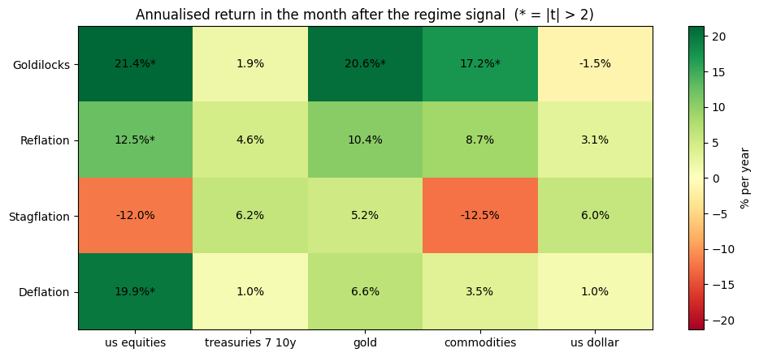
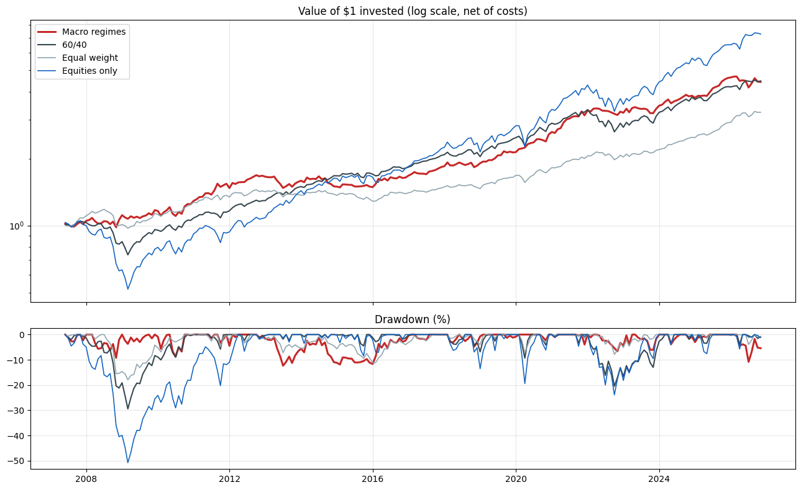
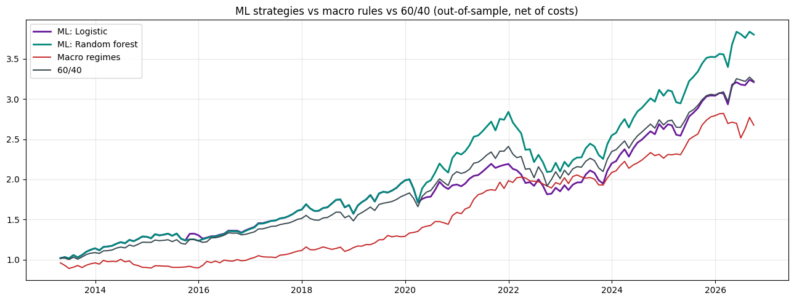

# Macroeconomic Regimes and Tactical Asset Allocation

[](https://colab.research.google.com/github/YOUR-USERNAME/macro-regimes-asset-allocation/blob/main/macro_regimes_asset_allocation.ipynb)

**Author:** Mattia Mariani, MSc Applied Economics and Finance, Copenhagen Business School

## Research question

Does the macroeconomic regime (growth and inflation accelerating or decelerating) help explain, and exploit, the returns of different asset classes?

The project tests the classic four-regime framework, the idea behind Merrill Lynch's "Investment Clock" and Bridgewater's "All Weather" portfolio, on US data from 2007 to today, and asks whether macro information can improve a standard 60/40 allocation.

## Framework

Each month is classified by the **direction** of growth and inflation relative to their trailing 12-month average:

| | Inflation ↓ | Inflation ↑ |
|---|---|---|
| **Growth ↑** | Goldilocks | Reflation |
| **Growth ↓** | Deflation | Stagflation |

Theory suggests equities do best in Goldilocks, commodities in Reflation, gold in Stagflation and government bonds in Deflation. The project checks whether the data agree.

## Data

| Source | Series | Role |
|---|---|---|
| FRED | Industrial production (YoY) | Growth |
| FRED | CPI (YoY) | Inflation |
| FRED | Unemployment rate | Labour-market cycle |
| FRED | Effective Fed Funds rate | Monetary policy |
| FRED | 10Y – 2Y Treasury spread | Yield-curve slope |
| FRED | BAA – 10Y spread | Credit risk |
| Yahoo Finance | SPY, IEF, GLD, DBC, UUP | US equities, 7-10Y Treasuries, gold, commodities, US dollar |

All data are free and downloaded automatically by the notebook. No API key is required.

## Methodology

1. **Avoiding look-ahead bias.** Monthly macro releases are lagged by one month to reflect publication delays (e.g. January CPI is released in mid-February). Market-based spreads are known at month end and are not lagged.
2. **Regime analysis.** The regime known at the end of month *t* is matched with asset returns in month *t+1*. For each asset-regime pair the notebook reports annualised return, volatility and the t-statistic of the mean.
3. **Rule-based strategy.** Portfolio weights for each regime are fixed ex ante from economic theory, not fitted to the data, then backtested net of 10 bp transaction costs against a 60/40, an equal-weight portfolio and equities only. A sensitivity analysis varies costs from 0 to 50 bp.
4. **Machine learning.** Logistic regression and a random forest predict whether equities will beat Treasuries in the following month, using macro levels, 3-month changes and 12-month relative momentum. Models are evaluated in an **expanding-window walk-forward** test (re-trained every month on past data only) and compared with a naive "most frequent class" benchmark.

## Results

> **Summary:** the macro regime helps less to earn more than to lose less. A simple strategy based on growth and inflation halved the maximum drawdown of a 60/40 portfolio at the same return, while machine learning added no value over a naive benchmark.

### 1. Asset returns by regime



Annualised return in the month after the regime signal (* = |t| > 2):

| Regime | Equities | Treasuries | Gold | Commodities |
|---|---|---|---|---|
| Goldilocks | +22%* | +1% | +16%* | +15% |
| Reflation | +14%* | +5% | +11% | +7% |
| Stagflation | −14% | +7% | +8% | −12% |
| Deflation | +19%* | +1% | +9% | 0% |

- **Stagflation is the clearest result.** It is the only regime in which equities and commodities lose money, while Treasuries and gold hold up, as the theory predicts. Equity volatility almost doubles (21% vs 11-15% in the other regimes).
- **Growth regimes favour equities**, with statistically significant returns in Goldilocks and Reflation.
- **Deflation is the surprise.** Theory points to Treasuries, but equities performed best. A plausible explanation is the post-2008 policy reaction: in slowdowns the Fed cut rates and ran QE, and the liquidity supported equities above all.

### 2. Regime strategy vs benchmarks



| Strategy | Annual return | Volatility | Sharpe | Max drawdown |
|---|---|---|---|---|
| **Macro regimes** | 8.5% | 8.8% | **0.98** | **−12.4%** |
| 60/40 | 8.1% | 9.5% | 0.86 | −29.5% |
| Equal weight | 5.9% | 6.6% | 0.89 | −18.0% |
| Equities only | 10.6% | 15.6% | 0.73 | −50.8% |

*Net of 10 bp transaction costs. Sharpe ratio computed without the risk-free rate.*

The regime strategy earns about the same as a 60/40 with **less than half its maximum drawdown**. Its value lies in avoiding crashes, mainly by reducing equity exposure when Stagflation arrives, rather than in higher returns. The result is robust to transaction costs: up to 30 bp, the Sharpe ratio remains above the 60/40's.

### 3. Machine learning (out-of-sample)



| Model | Out-of-sample accuracy |
|---|---|
| Naive (most frequent class) | 66.2% |
| Logistic regression | 63.6% |
| Random forest | 65.6% |

| Strategy (2013-2025) | Annual return | Volatility | Sharpe | Max drawdown |
|---|---|---|---|---|
| ML: Logistic | 9.1% | 9.9% | 0.94 | −17.3% |
| ML: Random forest | 10.4% | 11.1% | 0.95 | −26.4% |
| Macro regimes | 8.2% | 8.1% | **1.02** | **−10.9%** |
| 60/40 | 9.2% | 9.3% | 1.00 | −20.5% |

Equities beat Treasuries in 64% of months, so a naive model that always predicts "equities" is right 66% of the time. **Neither ML model beats this benchmark.** The random forest earns slightly more in the backtest, but with larger drawdowns and a lower Sharpe ratio than both the 60/40 and the macro rules. With few monthly observations and a low signal-to-noise ratio, the models fit relationships that do not persist out of sample, while simple theory-driven rules proved more robust.

## Limitations

- **Data revisions:** FRED provides revised data, not the real-time vintages markets observed. A natural extension is to use ALFRED vintages.
- **Missing data:** October 2025 CPI was never published because of the US government shutdown. The missing month is linearly interpolated.
- **Hindsight in the rules:** portfolio weights were set from economic theory, but the theory itself is partly shaped by past episodes in the sample (e.g. 2008, 2022).
- **Short sample:** about 17 years split across four regimes leaves limited observations per regime.
- **Researcher choices:** the regime threshold, portfolio weights and model parameters are discretionary, which creates a risk of data snooping.
- **Simplified costs:** drift rebalancing, variable bid-ask spreads and taxes are ignored.
- **US only:** results may not generalise to other markets.

## Possible extensions

- Macro **surprises** (actual minus consensus) instead of levels
- **Monetary-policy regimes** (hiking vs cutting cycles)
- Euro-area replication with ECB / Eurostat data
- Statistical regime detection with a **Hidden Markov Model**

## How to run

**Google Colab (recommended):** click the "Open in Colab" badge above, then *Runtime → Run all*.

**Locally:**
```bash
git clone https://github.com/YOUR-USERNAME/macro-regimes-asset-allocation.git
cd macro-regimes-asset-allocation
pip install -r requirements.txt
jupyter notebook macro_regimes_asset_allocation.ipynb
```

## Repository structure

```
├── macro_regimes_asset_allocation.ipynb   # full analysis
├── figures/                               # charts generated by the notebook
├── requirements.txt
└── README.md
```

---

*Research and educational project. Not investment advice.*
